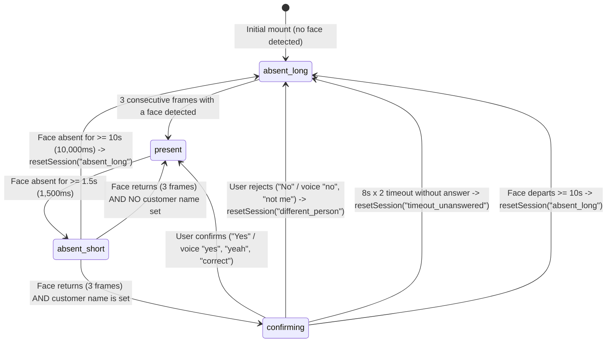

# FIX_REPORT_5: Presence-Based Kiosk Session Handling

## 1. Step 1 — Files and Line Numbers Located

| Component / Subsystem | File Path | Line Range | Description |
|---|---|---|---|
| **FaceLandmarker Detection Loop** | `src/hooks/useUserSignals.js` | Lines 40–92, Lines 100–160 | MediaPipe `FaceLandmarker` initialization and `lm.detectForVideo(video, perfNow)` frame loop |
| **Legacy Presence Camera Stream** | `src/lib/presence/usePresenceDetection.js` | Lines 137–194, Lines 248–372 | Camera stream initialization and distance estimation loop |
| **WebSocket Session Creation** | `src/hooks/useKiosk.js`<br>`src/lib/kioskWebSocket.js`<br>`src/lib/apiConfig.js` | `useKiosk.js` L61, L364–368, L406–408<br>`kioskWebSocket.js` L82–125<br>`apiConfig.js` L52–60 | `sessionIdRef`, `KioskStepCache.getOrCreateSessionId()`, `kioskWS.connect(sessionId, autoGreet)` |
| **Customer Name Storage** | `src/hooks/useKiosk.js`<br>`src/lib/kioskStepCache.js`<br>`src/lib/kioskWebSocket.js` | `useKiosk.js` L56, L87–88, L502–503<br>`kioskStepCache.js` L16, L88–96, L145–152<br>`kioskWebSocket.js` L628–633 | React state `name`, `nameRef`, sessionStorage key `greenie_kiosk_customer_name`, `KioskStepCache.clearCache()` |
| **Speech Queue & `clearQueue`** | `src/lib/avatar/GreenieAvatar.js`<br>`src/components/avatar/GreenieStage.jsx`<br>`src/hooks/useKiosk.js` | `GreenieAvatar.js` L553–647<br>`GreenieStage.jsx` L89–90<br>`useKiosk.js` L380, L477, L707, L752 | `clearQueue(reason)` generation token advance, audio cancel, promise resolution, and queue flush |

---

## 2. Presence State Machine

Presence detection is strictly **temporal and frame-count based**. Zero facial recognition, zero feature embeddings, and zero biometric data are collected or persisted.



### ASCII State Diagram

```
                 +-----------------------------------+
                 |           absent_long             |
                 |  (Idle / Reset Session Triggered) |
                 +-----------------+-----------------+
                                   |
                   3 consecutive   |   Face absent >= 10s
                   face frames     |   (resetSession)
                                   v
                 +-----------------------------------+
                 |             present               |<----------------+
                 |  (Customer engaged at kiosk)      |                 |
                 +-----------------+-----------------+                 |
                                   |                                   |
                  Face absent      |   Face returns < 1.5s             |
                  >= 1.5s          |   (ignored as head-turn)          |
                                   v                                   |
                 +-----------------------------------+                 |
                 |          absent_short             |                 |
                 |  (1.5s <= absence < 10.0s)        |                 |
                 +--------+------------------+-------+                 |
                          |                  |                         |
           Face returns   |                  | Face returns            |
           (Name is set)  |                  | (No name set)           |
                          v                  |                         |
                 +-------------------+       +-------------------------+
                 |    confirming     |
                 | "Are you still X?"|
                 +---+-----------+---+
                     |           |
    "No" / "Not me"  |           | "Yes" / "Yeah" / "Correct"
    or 8s x 2 timeout|           +-------------------------------------+
                     v
             resetSession(...)
```

---

## 3. Configuration Constants (`src/lib/presenceConfig.js`)

```javascript
export const PRESENCE_CONFIG = {
  // Absence thresholds
  ABSENT_SHORT_MS: 1500,          // 1.5s: Brief head turn threshold vs genuine absence
  ABSENT_LONG_MS: 10000,          // 10s: Customer departure threshold -> resetSession("absent_long")

  // Debounce: consecutive frames with a face required to confirm presence
  PRESENCE_FRAMES: 3,

  // Identity verification modal timeout (Step 3: 8s per prompt, max 2 attempts)
  CONFIRMATION_TIMEOUT_MS: 8000,

  // Session reset debounce (Step 5: cannot run twice within 2s)
  RESET_DEBOUNCE_MS: 2000,

  // Maximum faces detected concurrently by MediaPipe FaceLandmarker (Step 6)
  MAX_FACES: 4,
};
```

---

## 4. Key Architectural Changes

1. **Continuous FaceLandmarker Evaluation (`src/hooks/useUserSignals.js`)**:
   - Initialized `FaceLandmarker` with `numFaces: 4` for both WebGL GPU and CPU fallback.
   - Evaluates video frames continuously regardless of `isEngaged` state so arrivals and departures are caught without latency.
   - Computes 2D bounding boxes across all detected faces to isolate the primary closest face (`largestFace`).
   - Dispatches raw landmarks via `onFaceResult` to feed `usePresence`.

2. **Presence Hook (`src/hooks/usePresence.js`)**:
   - Requires 3 consecutive frames with a face (`PRESENCE_FRAMES: 3`) to confirm presence.
   - Transitions between `present`, `absent_short`, `absent_long`, and `confirming`.
   - Logs every transition timestamp and elapsed milliseconds:
     `[Presence] ts=... Transition: present -> absent_short (elapsed=...ms)`.
   - Flags `multipleFaces = facesCount > 1` and logs throttled `[Presence] multiple faces (N)`.

3. **Session Reset Engine (`src/hooks/useKiosk.js`)**:
   - Debounced to prevent running twice within 2 seconds (`RESET_DEBOUNCE_MS: 2000`).
   - Aborts in-flight SSE/TTS fetches via `AbortController`.
   - Calls `stageRef.current?.clearQueue("session_reset")` and `stageRef.current?.stop("session_reset")`.
   - Clears customer name, stage, live captions (`GREETING`), modals, product filters, and `KioskStepCache.clearCache()`.
   - Generates a new session ID, issues WebSocket reconnection with `auto_greet=1`, and calls `resetBackendSession(oldSession)`.
   - Ignores late frames arriving from the previous WebSocket session.

4. **Short-Gap Identity Verification (`src/components/modals/IdentityVerificationModal.jsx`)**:
   - Triggers when a face returns after 1.5s to 10s absence and a customer name was set.
   - Greenie speaks: `"Welcome back! Are you still <name>?"`.
   - UI displays "Yes, I am <name>" and "No, I'm someone new" buttons.
   - Accepts voice responses:
     - Positive (`yes`, `yeah`, `correct`, `that's me`, `sure`): verifies identity and continues.
     - Negative (`no`, `not me`, `someone new`, `different person`): triggers `resetSession("different_person")`.
   - 8-second countdown timer. If unanswered, repeats prompt once; if still unanswered after second 8s, calls `resetSession("timeout_unanswered")`.

5. **Multiple Faces Name Suppression (Step 6)**:
   - When `multipleFaces` is active (`facesCount > 1`), passes empty string `name: ""` to `replyAsync`.
   - Automatically sanitizes streamed sentence audio and caption text: replaces occurrences of the user's name with neutral `"you"` or `"Hello there,"` until only one face remains.

6. **Manual Overrides (Step 7)**:
   - Visible `"Not <name>?"` buttons added to `RightNavbar` and `RightOnboardingFlow` calling `resetSession("user_tap")`.
   - Spoken override phrases (`"I am someone else"`, `"not <name>"`, `"start over"`, `"new customer"`, `"that's not me"`) immediately trigger `resetSession("user_speech")`.

7. **Privacy Notice (Step 8)**:
   - Subtle banner displayed near camera view:
     `"📷 Camera is used only to detect presence. No faces are stored."`

---

## 5. Full Git Diff

```diff
diff --git a/src/app/globals.css b/src/app/globals.css
index 5e638fb..fffc2cf 100644
--- a/src/app/globals.css
+++ b/src/app/globals.css
@@ -5,3 +5,4 @@
 @import "../styles/products.css";
 @import "../styles/navbar.css";
 @import "../styles/ecommerce.css";
+@import "../styles/presence.css";
diff --git a/src/components/avatar/AvatarPanel.jsx b/src/components/avatar/AvatarPanel.jsx
index 1017cba..897086d 100644
--- a/src/components/avatar/AvatarPanel.jsx
+++ b/src/components/avatar/AvatarPanel.jsx
@@ -254,6 +254,12 @@ export default function AvatarPanel({
         width={320} height={240}
       />
 
+      {/* Subtle Camera Privacy Notice (Step 8) */}
+      <div className="camera-privacy-badge" aria-label="Privacy Notice">
+        <span className="privacy-camera-icon">📷</span>
+        <span>Camera is used only to detect presence. No faces are stored.</span>
+      </div>
+
       {/* ── ATTRACT SCREEN ── */}
       <div
         className={`kiosk-layer attract-layer ${!isEngaged ? "kiosk-layer--active" : "kiosk-layer--hidden"}`}
diff --git a/src/components/kiosk/KioskShell.jsx b/src/components/kiosk/KioskShell.jsx
index 61dc2fc..cbaea9b 100644
--- a/src/components/kiosk/KioskShell.jsx
+++ b/src/components/kiosk/KioskShell.jsx
@@ -9,6 +9,7 @@ import GoodbyeOverlay from "@/components/modals/GoodbyeOverlay";
 import StaffAssistanceBanner from "@/components/kiosk/StaffAssistanceBanner";
 import HintTooltip from "@/components/kiosk/HintTooltip";
 import SessionTimeoutBanner from "@/components/kiosk/SessionTimeoutBanner";
+import IdentityVerificationModal from "@/components/modals/IdentityVerificationModal";
 import { useKiosk } from "@/hooks/useKiosk";
 
 export default function KioskShell() {
@@ -20,6 +21,16 @@ export default function KioskShell() {
       onClick={() => k.presence.triggerTouchEngaged()}
       onTouchStart={() => k.presence.triggerTouchEngaged()}
     >
+      {/* ── Identity Verification Modal (Step 3: Short Gap Return) ── */}
+      <IdentityVerificationModal
+        isOpen={Boolean(k.identityPrompt?.active)}
+        name={k.identityPrompt?.name || k.name}
+        secondsRemaining={k.identityPrompt?.secondsRemaining ?? 8}
+        promptCount={k.identityPrompt?.promptCount ?? 1}
+        onConfirm={k.confirmIdentity}
+        onReject={() => k.resetSession("different_person")}
+      />
+
       {/* ── Top-Right Inactivity Warning Banner (15s not seeing -> 10s timer -> Reset to Step 1) ── */}
       <SessionTimeoutBanner
         isOpen={k.sessionTimeoutWarning?.active}
@@ -95,6 +106,8 @@ export default function KioskShell() {
           showDetail={k.showDetail}
           onCloseDetail={() => k.setShowDetail(false)}
           actionButtons={k.actionButtons}
           onButtonClick={k.handleButtonClick}
+          name={k.name}
+          onResetSession={k.resetSession}
         />
 
         {/* ── Right-Side Onboarding Flow (Step 1: Ask Name, Step 2: Categories) ── */}
@@ -124,6 +137,7 @@ export default function KioskShell() {
           onGoToAllProducts={() => {
             k.showAll();
           }}
+          onResetSession={k.resetSession}
         />
 
         {/* ── Cart Confirmation Modal (CONFIRM_BUY) ── */}
diff --git a/src/components/kiosk/RightOnboardingFlow.jsx b/src/components/kiosk/RightOnboardingFlow.jsx
index ec9713c..6187b41 100644
--- a/src/components/kiosk/RightOnboardingFlow.jsx
+++ b/src/components/kiosk/RightOnboardingFlow.jsx
@@ -17,6 +17,7 @@ export default function RightOnboardingFlow({
   onSelectCategory,
   onSelectProduct,
   onGoToAllProducts,
+  onResetSession,
 }) {
   // step: 1 = Ask Name, 2 = Show Categories & Recommendations
   const [step, setStep] = useState(controlledStep || 1);
@@ -231,7 +232,21 @@ export default function RightOnboardingFlow({
             <div className="right-step-eyebrow">
               <span className="step-num-badge step-num-badge--green">Step 2 of 2</span>
               <span className="step-badge-text">
-                {name || inputName ? `🌿 Curated for ${name || inputName}` : "🌿 Sustainable Collections"}
+                {name || inputName ? (
+                  <>
+                    <span>🌿 Curated for <strong>{name || inputName}</strong></span>
+                    <button
+                      type="button"
+                      className="flow-not-me-btn"
+                      onClick={() => onResetSession?.("user_tap")}
+                      title={`Not ${name || inputName}? Tap to start fresh`}
+                    >
+                      Not {name || inputName}?
+                    </button>
+                  </>
+                ) : (
+                  "🌿 Sustainable Collections"
+                )}
               </span>
             </div>
diff --git a/src/components/navigation/RightNavbar.jsx b/src/components/navigation/RightNavbar.jsx
index de92bf0..416a22b 100644
--- a/src/components/navigation/RightNavbar.jsx
+++ b/src/components/navigation/RightNavbar.jsx
@@ -6,6 +6,8 @@ export default function RightNavbar({
   productCount = 0,
   onOpenMenu,
   onSelectCategory,
+  name = "",
+  onResetSession,
 }) {
   return (
     <nav className="right-navbar" aria-label="Catalog Navigation Bar">
@@ -53,6 +55,19 @@ export default function RightNavbar({
 
       {/* ── Center: Sustainability & Eco Highlights ── */}
       <div className="right-navbar__center">
+        {name ? (
+          <div className="navbar-user-chip">
+            <span className="navbar-user-name">👤 {name}</span>
+            <button
+              type="button"
+              className="navbar-not-me-btn"
+              onClick={() => onResetSession?.("user_tap")}
+              title={`Not ${name}? Tap to start fresh`}
+            >
+              Not {name}?
+            </button>
+          </div>
+        ) : null}
         <div className="navbar-eco-badge">
           <span className="eco-leaf-icon">🌾</span>
           <span>Zero Virgin Plastic</span>
diff --git a/src/components/products/ProductShowcase.jsx b/src/components/products/ProductShowcase.jsx
index 5493c8d..f6b6eb2 100644
--- a/src/components/products/ProductShowcase.jsx
+++ b/src/components/products/ProductShowcase.jsx
@@ -18,6 +18,8 @@ export default function ProductShowcase({
   onCloseDetail,
   actionButtons = [],
   onButtonClick,
+  name = "",
+  onResetSession,
 }) {
   const [view, setView] = useState("catalog"); // "catalog" | "detail" | "checkout" | "success"
   const [selectedProduct, setSelectedProduct] = useState(null);
@@ -90,6 +92,8 @@ export default function ProductShowcase({
         productCount={products?.length || 0}
         onOpenMenu={() => setIsSidebarOpen(true)}
         onSelectCategory={handleSidebarCategory}
+        name={name}
+        onResetSession={onResetSession}
       />
 
       {/* ── Premium Sidebar Drawer ── */}
diff --git a/src/hooks/useKiosk.js b/src/hooks/useKiosk.js
index 9b93e62..1397dc8 100644
--- a/src/hooks/useKiosk.js
+++ b/src/hooks/useKiosk.js
@@ -35,6 +35,14 @@ import {
 import { kioskWS } from "@/lib/kioskWebSocket";
 import KioskStepCache, { KIOSK_STEPS } from "@/lib/kioskStepCache";
 import { usePresenceDetection } from "@/lib/presence/usePresenceDetection";
+import { usePresence } from "@/hooks/usePresence";
+import {
+  PRESENCE_CONFIG,
+  ABSENT_SHORT_MS,
+  ABSENT_LONG_MS,
+  CONFIRMATION_TIMEOUT_MS,
+  RESET_DEBOUNCE_MS,
+} from "@/lib/presenceConfig";
 import { useUserSignals } from "@/hooks/useUserSignals";
 import { useMic } from "@/hooks/useMic";
 import { useUserSpeechState } from "@/hooks/useUserSpeechState";
@@ -163,8 +171,92 @@ export function useKiosk() {
   // ── Latest Ref Pattern for zero stale closures across async handlers ───────
   const latestRef = useRef({});
 
-  // ── Presence Hook ────────────────────────────────────────────────────────
-  const presence = usePresenceDetection({
+  // ── Short Gap Identity Verification State ──
+  const [identityPrompt, setIdentityPrompt] = useState({
+    active: false,
+    name: "",
+    promptCount: 1,
+    secondsRemaining: 8,
+  });
+  const identityPromptRef = useRef(identityPrompt);
+  identityPromptRef.current = identityPrompt;
+  const identityTimerRef = useRef(null);
+  const identityIntervalRef = useRef(null);
+
+  // ── Presence State Machine (usePresence fed by FaceLandmarker) ────────────
+  const presenceTracker = usePresence({
+    getName: useCallback(() => nameRef.current || KioskStepCache.getCustomerName(), []),
+    onShortGapReturn: useCallback(({ elapsed, name: returningName }) => {
+      console.log(`[Presence] Short gap return (${elapsed}ms) with name="${returningName}". Initiating verification prompt.`);
+      const stage = stageRef.current || latestRef.current._stageRef?.current;
+      stage?.clearQueue?.("identity_verification");
+      stage?.speak?.(`Welcome back! Are you still ${returningName}?`);
+      setCaption(`Welcome back! Are you still ${returningName}?`);
+
+      clearTimeout(identityTimerRef.current);
+      clearInterval(identityIntervalRef.current);
+
+      let secLeft = 8;
+      setIdentityPrompt({
+        active: true,
+        name: returningName,
+        promptCount: 1,
+        secondsRemaining: 8,
+      });
+
+      identityIntervalRef.current = setInterval(() => {
+        secLeft -= 1;
+        setIdentityPrompt((prev) => ({
+          ...prev,
+          secondsRemaining: Math.max(0, secLeft),
+        }));
+      }, 1000);
+
+      identityTimerRef.current = setTimeout(() => {
+        // Attempt 1 expired after 8s: ask again once
+        clearInterval(identityIntervalRef.current);
+        console.log(`[Presence] Verification prompt 1 unanswered after 8s. Repeating prompt once.`);
+        const st = stageRef.current || latestRef.current._stageRef?.current;
+        st?.clearQueue?.("identity_repeat");
+        st?.speak?.(`Are you still ${returningName}?`);
+        setCaption(`Are you still ${returningName}?`);
+
+        secLeft = 8;
+        setIdentityPrompt({
+          active: true,
+          name: returningName,
+          promptCount: 2,
+          secondsRemaining: 8,
+        });
+
+        identityIntervalRef.current = setInterval(() => {
+          secLeft -= 1;
+          setIdentityPrompt((prev) => ({
+            ...prev,
+            secondsRemaining: Math.max(0, secLeft),
+          }));
+        }, 1000);
+
+        identityTimerRef.current = setTimeout(() => {
+          // Attempt 2 expired after another 8s: reset session
+          clearInterval(identityIntervalRef.current);
+          console.log(`[Presence] Verification prompt 2 unanswered after 8s. Resetting session.`);
+          setIdentityPrompt({ active: false, name: "", promptCount: 1, secondsRemaining: 8 });
+          latestRef.current.resetSession?.("timeout_unanswered");
+        }, 8000);
+      }, 8000);
+    }, []),
+    onLongGapAbsent: useCallback(({ elapsed }) => {
+      console.log(`[Presence] Long gap absence (${elapsed}ms >= 10s). Resetting session.`);
+      clearTimeout(identityTimerRef.current);
+      clearInterval(identityIntervalRef.current);
+      setIdentityPrompt({ active: false, name: "", promptCount: 1, secondsRemaining: 8 });
+      latestRef.current.resetSession?.("absent_long");
+    }, []),
+  });
+
+  // ── Camera & Hardware Presence Hook ───────────────────────────────────────
+  const cameraPresence = usePresenceDetection({
     onEnterEngaged: useCallback(() => {
       lastFaceAtRef.current = Date.now();
       if (convStateRef.current === S.IDLE) {
@@ -171,7 +263,6 @@ export function useKiosk() {
       }
     }, [setConv]),
     onExitToIdle: useCallback(() => {
-      // The presence hook only reports face movement; fused tracker is single reset authority
       if (convStateRef.current === S.ATTENTIVE) {
         setConv(S.IDLE);
       }
@@ -178,5 +269,17 @@ export function useKiosk() {
   });
 
+  // Unified presence object: full backward-compatible props + presenceTracker state
+  const presence = {
+    ...cameraPresence,
+    ...presenceTracker,
+    state:
+      presenceTracker.presenceState === "present" ||
+      presenceTracker.presenceState === "confirming" ||
+      cameraPresence.state === "ENGAGED"
+        ? "ENGAGED"
+        : "IDLE",
+  };
+
   const isEngaged = presence.state === "ENGAGED" || onboardingOpen;
 
   // Sync engagement presence state with Electron main process
@@ -185,12 +288,13 @@ export function useKiosk() {
     }
   }, [isEngaged]);
 
-  // ── Face signals (jaw-open VAD in useUserSignals) ─────────────────────────
+  // ── Face signals (jaw-open VAD in useUserSignals) fed continuously ─────────
   const signals = useUserSignals({
-    videoRef: presence.videoRef,
+    videoRef: cameraPresence.videoRef,
     isEngaged,
     onSpeechStart: useCallback(() => {}, []),
     onSpeechEnd:   useCallback(() => {}, []),
+    onFaceResult:  presenceTracker.handleFaceLandmarks,
   });
 
   // Build the face object expected by useUserSpeechState (reads facePx from ref to avoid re-renders)
@@ -447,11 +551,35 @@ export function useKiosk() {
     setSpeechId((p) => p + 1);
   }, []);
 
-  // ── Reset session to Step 1 ──────────────────────────────────────────────
-  const reset = useCallback(() => {
+  const lastResetAtRef = useRef(0);
+
+  // ── Reset session to Step 1 (presence-based or manual) ───────────────────
+  const resetSession = useCallback((reason = "unknown") => {
+    const now = Date.now();
+    if (now - lastResetAtRef.current < RESET_DEBOUNCE_MS) {
+      console.log(`[Session] reset debounced (<${RESET_DEBOUNCE_MS}ms since last reset, reason=${reason})`);
+      return;
+    }
+    lastResetAtRef.current = now;
+
+    const oldSession = sessionIdRef.current;
+    const newSession = "sess_" + Date.now() + "_" + Math.random().toString(36).substring(2, 7);
+    console.log(`[Session] reset reason=${reason} oldSession=${oldSession} newSession=${newSession}`);
+
+    // Clear verification prompt & intervals
+    clearTimeout(identityTimerRef.current);
+    clearInterval(identityIntervalRef.current);
+    setIdentityPrompt({ active: false, name: "", promptCount: 1, secondsRemaining: 8 });
+
     warningDeadlineRef.current = null;
     setSessionTimeoutWarning({ active: false, secondsRemaining: 10 });
     lastFaceAtRef.current = now;
     lastAttentionAtRef.current = now;
     lastVoiceAtRef.current = now;
     lastInputAtRef.current = now;
@@ -458,8 +586,35 @@ export function useKiosk() {
 
     nameSubmittedRef.current = false;
     clearTimeout(categoriesFallbackTimerRef.current);
+
+    // Stop speech and clear audio queue immediately
+    const stage = stageRef.current || latestRef.current._stageRef?.current;
+    stage?.clearQueue?.("session_reset");
+    stage?.stop?.("session_reset");
+    abortRef.current?.abort();
+    abortRef.current = null;
+    if (typeof window !== "undefined") {
+      try { window.speechSynthesis?.cancel(); } catch (_) {}
+    }
+    setSpeaking(false);
+    convStateRef.current = S.IDLE;
+    setConv(S.IDLE);
+
+    // Drop pending speech acknowledgments & timers
+    pendingSpeechAckRef.current = null;
+    clearTimeout(speechAckTimerRef.current);
+    if (kioskWS.speechDoneTimer) {
+      clearTimeout(kioskWS.speechDoneTimer);
+      kioskWS.speechDoneTimer = null;
+    }
+    kioskWS.pendingSpeechId = null;
+
+    // Fully clear cache and presence state
     KioskStepCache.clearCache();
+    presenceTracker.forceResetPresence();
+
     setName("");
+    nameRef.current = "";
     setCategory("all");
     setProductId(backendCatalog[0]?.id || null);
     setCaption(GREETING);
@@ -466,5 +621,4 @@ export function useKiosk() {
-    const oldSession = sessionIdRef.current;
-    const newSession = "sess_" + Date.now() + "_" + Math.random().toString(36).substring(2, 7);
+    // Connect new WebSocket session with auto_greet=1
     KioskStepCache.setSessionId(newSession);
     sessionIdRef.current = newSession;
     kioskWS.connect(newSession, true);
@@ -471,15 +625,4 @@ export function useKiosk() {
 
-    pendingSpeechAckRef.current = null;
-    clearTimeout(speechAckTimerRef.current);
-    if (kioskWS.speechDoneTimer) {
-      clearTimeout(kioskWS.speechDoneTimer);
-      kioskWS.speechDoneTimer = null;
-    }
-    kioskWS.pendingSpeechId = null;
-
-    // Stop any in-flight TTS so stale replies from old turn never play
-    stageRef.current?.stop();
-
     setBackendAction(null);
     setActionButtons([]);
     setCartModalOpen(false);
@@ -493,7 +635,6 @@ export function useKiosk() {
     setOnboardingOpen(false);
     setOnboardingStep(1);
     setSpeechId((p) => p + 1);
-    setConv(S.IDLE);
     pendingTranscriptRef.current = "";
     setLastUserSpeech("");
     setLiveTranscript("");
@@ -500,5 +641,35 @@ export function useKiosk() {
     setShowPTT(false);
-  }, [backendCatalog, setConv]);
+  }, [backendCatalog, setConv, presenceTracker]);
+
+  const reset = useCallback((reason) => {
+    resetSession(reason || "manual_reset");
+  }, [resetSession]);
+
+  // ── Affirmative identity confirmation (same person returned) ─────────────
+  const confirmIdentity = useCallback(() => {
+    clearTimeout(identityTimerRef.current);
+    clearInterval(identityIntervalRef.current);
+    setIdentityPrompt({ active: false, name: "", promptCount: 1, secondsRemaining: 8 });
+    presenceTracker.confirmSamePerson();
+
+    const stage = stageRef.current || latestRef.current._stageRef?.current;
+    stage?.clearQueue?.("identity_confirmed");
+    const currentName = nameRef.current;
+    const msg = `Great to have you back${currentName ? `, ${currentName}` : ""}! What can I help you with?`;
+    stage?.speak?.(msg);
+    setCaption(msg);
+  }, [presenceTracker]);
+
+  // ── Multiple Faces speech sanitizer ──────────────────────────────────────
+  const sanitizeForMultipleFaces = useCallback((text) => {
+    if (!text || !presenceTracker.multipleFaces) return text;
+    const currentName = nameRef.current || KioskStepCache.getCustomerName();
+    if (!currentName) return text;
+    const escaped = currentName.replace(/[.*+?^${}()|[\]\\]/g, "\\$&");
+    return text
+      .replace(new RegExp(`\\b(?:Hey|Hi|Hello)\\s+${escaped}[,!.]?`, "gi"), "Hello there,")
+      .replace(new RegExp(`\\b${escaped}\\b`, "gi"), "you");
+  }, [presenceTracker.multipleFaces]);
 
 
   // Connect WebSocket on mount for current session with auto_greet
@@ -1042,7 +1213,8 @@ export function useKiosk() {
       setConv(S.SPEAKING);
       const stage = stageRef.current || latestRef.current._stageRef?.current;
       if (stage && typeof stage.enqueueSentence === "function") {
-        stage.enqueueSentence(sentence, { turnId });
+        const textToSpeak = sanitizeForMultipleFaces(sentence);
+        stage.enqueueSentence(textToSpeak, { turnId });
       } else {
         console.warn(`[Kiosk] Dropping sentence: stage not ready (sentence="${sentence.slice(0, 30)}")`);
       }
@@ -1054,7 +1226,7 @@ export function useKiosk() {
       }
       if (doneData?.reply && typeof doneData.reply === "string" && doneData.reply.trim().length > 0) {
         const turnId = doneData?.turnId || doneData?.meta?.turn_id;
-        const replyText = doneData.reply.trim();
+        const replyText = sanitizeForMultipleFaces(doneData.reply.trim());
         setCaption(replyText);
 
         const stage = stageRef.current || latestRef.current._stageRef?.current;
@@ -1079,7 +1251,7 @@ export function useKiosk() {
 
     const unsubAutoReset = kioskWS.on("auto_reset", (msg) => {
       if (!isEngaged && !onboardingOpen && !nameRef.current && !KioskStepCache.getCustomerName()) {
-        latestRef.current.reset?.();
+        latestRef.current.resetSession?.("auto_reset");
       }
     });
 
@@ -1143,9 +1315,29 @@ export function useKiosk() {
       }
     }
 
-    // ── Spoken restart intent ──
-    if (/^(?:restart|start over|reset|new session)$/i.test(trimmed)) {
-      latestRef.current.restartSession?.();
+    // ── Spoken answers during identity verification (Step 3) ──
+    if (latestRef.current.identityPrompt?.active) {
+      if (/^(?:yes|yeah|yep|correct|that's me|i am|right|sure|it is|it's me)\b/i.test(trimmed)) {
+        console.log("[Presence] Voice affirmative verification received:", trimmed);
+        latestRef.current.confirmIdentity?.();
+        return;
+      }
+      if (/^(?:no|nope|nah|not me|i am not|i'm not|someone new|different person|new customer|new)\b/i.test(trimmed)) {
+        console.log("[Presence] Voice rejection / different person received:", trimmed);
+        latestRef.current.resetSession?.("different_person");
+        return;
+      }
+    }
+
+    // ── Spoken restart / identity override intent (Step 7) ──
+    const activeName = latestRef.current.name || KioskStepCache.getCustomerName() || "";
+    const escapedName = activeName ? activeName.replace(/[.*+?^${}()|[\]\\]/g, "\\$&") : "";
+    const notNamePattern = escapedName ? `(?:i am not|i'm not|not)\\s+${escapedName}|` : "";
+    const isOverrideIntent = new RegExp(`^(?:${notNamePattern}i am someone else|i'm someone else|someone else|someone new|different person|new customer|start over|restart|reset|that's not me|not me)$`, "i").test(trimmed);
+
+    if (isOverrideIntent) {
+      console.log("[Kiosk] Spoken identity override detected:", trimmed);
+      latestRef.current.resetSession?.("user_speech");
       return;
     }
 
@@ -1164,9 +1356,10 @@ export function useKiosk() {
     stage?.startTurn?.("turn_" + Date.now());
 
     try {
+      const effectiveName = latestRef.current.multipleFaces ? "" : String(nameRef.current ?? "");
       const data = await replyAsync({
         text: String(text ?? ""),
-        name: String(nameRef.current ?? ""),
+        name: effectiveName,
         sessionId: sessionIdRef.current,
         signals: signalsSnap,
         signal: abortRef.current.signal,
@@ -1640,6 +1833,11 @@ export function useKiosk() {
     sessionId: sessionIdRef.current,
     say,
     reset,
+    resetSession,
+    identityPrompt,
+    confirmIdentity,
+    multipleFaces: presence.multipleFaces,
+    setCaption,
     submitName,
     skipName,
     showAll,
@@ -1684,6 +1882,9 @@ export function useKiosk() {
     setShowDetail,
     enquire,
     reset,
+    resetSession,
+    identityPrompt,
+    confirmIdentity,
     handleButtonClick,
     cartModalOpen,
     setCartModalOpen,
diff --git a/src/hooks/useUserSignals.js b/src/hooks/useUserSignals.js
index be0f2f2..7e9e961 100644
--- a/src/hooks/useUserSignals.js
+++ b/src/hooks/useUserSignals.js
@@ -5,6 +5,7 @@
 // Attention (Screen vs Away), and Voice Activity (Jaw movement).
 
 import { useEffect, useRef, useCallback, useState } from "react";
+import { MAX_FACES } from "@/lib/presenceConfig";
 
 const SIGNAL_INTERVAL_MS = 150; // ~7 FPS
 const LOG_INTERVAL_MS = 1200;   // Log update interval
@@ -24,7 +25,7 @@ const DEFAULT_SIGNALS = {
   dwellMs: 0,
 };
 
-export function useUserSignals({ videoRef, isEngaged, onSpeechStart, onSpeechEnd } = {}) {
+export function useUserSignals({ videoRef, isEngaged, onSpeechStart, onSpeechEnd, onFaceResult } = {}) {
   const [signals, setSignals] = useState(DEFAULT_SIGNALS);
   const landmarkerRef = useRef(null);
   const timerRef = useRef(null);
@@ -36,6 +37,7 @@ export function useUserSignals({ videoRef, isEngaged, onSpeechStart, onSpeechEnd
   const lastTimestampRef = useRef(0);
   const lastLogTimeRef = useRef(0);
   const lastLoggedMoodRef = useRef("");
+  const lastMultiLogRef = useRef(0);
 
   // --- Initialise MediaPipe FaceLandmarker ---
   useEffect(() => {
@@ -58,7 +60,7 @@ export function useUserSignals({ videoRef, isEngaged, onSpeechStart, onSpeechEnd
             },
             runningMode: "VIDEO",
             outputFaceBlendshapes: true,
-            numFaces: 1,
+            numFaces: MAX_FACES || 4,
           });
         } catch (gpuErr) {
           console.warn("GPU delegate unavailable for FaceLandmarker, switching to CPU:", gpuErr);
@@ -69,7 +71,7 @@ export function useUserSignals({ videoRef, isEngaged, onSpeechStart, onSpeechEnd
             },
             runningMode: "VIDEO",
             outputFaceBlendshapes: true,
-            numFaces: 1,
+            numFaces: MAX_FACES || 4,
           });
         }
 
@@ -100,16 +102,6 @@ export function useUserSignals({ videoRef, isEngaged, onSpeechStart, onSpeechEnd
   useEffect(() => {
     clearInterval(timerRef.current);
 
-    if (!isEngaged) {
-      engagedSinceRef.current = null;
-      silenceSecRef.current = 0;
-      isSpeakingRef.current = false;
-      setSignals(DEFAULT_SIGNALS);
-      return;
-    }
-
-    if (!engagedSinceRef.current) engagedSinceRef.current = Date.now();
-
     timerRef.current = setInterval(() => {
       const video = videoRef?.current;
       const lm = landmarkerRef.current;
@@ -118,13 +110,15 @@ export function useUserSignals({ videoRef, isEngaged, onSpeechStart, onSpeechEnd
 
       // Guard: video must be ready and displaying frames
       if (!video || video.readyState < 2 || !lm || video.paused) {
-        const dwell = now - (engagedSinceRef.current || now);
-        silenceSecRef.current += SIGNAL_INTERVAL_MS / 1000;
-        setSignals((prev) => ({
-          ...prev,
-          dwellMs: dwell,
-          silenceSec: Math.round(silenceSecRef.current),
-        }));
+        if (isEngaged) {
+          const dwell = now - (engagedSinceRef.current || now);
+          silenceSecRef.current += SIGNAL_INTERVAL_MS / 1000;
+          setSignals((prev) => ({
+            ...prev,
+            dwellMs: dwell,
+            silenceSec: Math.round(silenceSecRef.current),
+          }));
+        }
         return;
       }
 
@@ -136,7 +130,58 @@ export function useUserSignals({ videoRef, isEngaged, onSpeechStart, onSpeechEnd
 
       try {
         const result = lm.detectForVideo(video, perfNow);
-        const bs = result.faceBlendshapes?.[0]?.categories ?? [];
+        const faceLandmarks = result.faceLandmarks || [];
+        const facesCount = faceLandmarks.length;
+
+        // Calculate largest face by 2D bounding box
+        let largestFace = null;
+        let maxArea = -1;
+        if (facesCount > 0) {
+          for (let i = 0; i < facesCount; i++) {
+            const lmPoints = faceLandmarks[i];
+            if (!lmPoints || lmPoints.length === 0) continue;
+            let minX = 1, maxX = 0, minY = 1, maxY = 0;
+            for (const pt of lmPoints) {
+              if (pt.x < minX) minX = pt.x;
+              if (pt.x > maxX) maxX = pt.x;
+              if (pt.y < minY) minY = pt.y;
+              if (pt.y > maxY) maxY = pt.y;
+            }
+            const width = Math.max(0, maxX - minX);
+            const height = Math.max(0, maxY - minY);
+            const area = width * height;
+            if (area > maxArea) {
+              maxArea = area;
+              largestFace = { index: i, box: { minX, maxX, minY, maxY, width, height }, area };
+            }
+          }
+        }
+
+        // Log multiple faces if detected (throttled)
+        if (facesCount > 1) {
+          if (now - lastMultiLogRef.current > 3000) {
+            lastMultiLogRef.current = now;
+            console.log(`[Presence] multiple faces (${facesCount})`);
+          }
+        }
+
+        // Feed presence tracking hook with raw face landmarks
+        onFaceResult?.(faceLandmarks, perfNow, { facesCount, largestFace });
+
+        // If kiosk is not engaged, reset engagement metrics and skip emotion processing
+        if (!isEngaged) {
+          engagedSinceRef.current = null;
+          silenceSecRef.current = 0;
+          isSpeakingRef.current = false;
+          setSignals(DEFAULT_SIGNALS);
+          return;
+        }
+
+        if (!engagedSinceRef.current) engagedSinceRef.current = Date.now();
+
+        // Extract blendshapes for the primary (largest) face
+        const primaryFaceIdx = largestFace?.index ?? 0;
+        const bs = result.faceBlendshapes?.[primaryFaceIdx]?.categories ?? [];
         const present = bs.length > 0;
 
         if (!present) {
@@ -298,7 +343,7 @@ export function useUserSignals({ videoRef, isEngaged, onSpeechStart, onSpeechEnd
     }, SIGNAL_INTERVAL_MS);
 
     return () => clearInterval(timerRef.current);
-  }, [isEngaged, videoRef, score, onSpeechStart, onSpeechEnd]);
+  }, [isEngaged, videoRef, score, onSpeechStart, onSpeechEnd, onFaceResult]);
 
   return signals;
 }
diff --git a/src/lib/kioskWebSocket.js b/src/lib/kioskWebSocket.js
index 91f750e..721772f 100644
--- a/src/lib/kioskWebSocket.js
+++ b/src/lib/kioskWebSocket.js
@@ -114,6 +114,7 @@ class KioskWebSocketClient {
     try {
       console.log(`[FRONTEND >> WS CONNECT] Connecting (${CURRENT_ENV}) to:`, wsUrl, `[autoGreet=${shouldAutoGreet}, step=${KioskStepCache.getCurrentStep()}]`);
       this.ws = new WebSocket(wsUrl);
+      this.ws.sessionId = resolvedSessionId;
 
       this.ws.onopen = () => {
         this.connected = true;
@@ -182,10 +183,23 @@ class KioskWebSocketClient {
 
   // ── Incoming Frame Parser ──
   handleMessage(event) {
+    // Guard: ignore messages from old/closed sockets
+    if (event.target && event.target !== this.ws) {
+      console.log(`[KioskWS] Dropping late frame from closed socket (sockSession=${event.target?.sessionId}, currentSession=${this.sessionId})`);
+      return;
+    }
+
     try {
       const payload = JSON.parse(event.data);
       const { type, data, meta, metadata } = payload;
 
+      // Check session ID if present in payload or meta to drop stale messages from previous session
+      const incomingSession = payload.session_id || payload.sessionId || meta?.session_id;
+      if (incomingSession && incomingSession !== this.sessionId) {
+        console.log(`[KioskWS] Dropping late frame for session mismatch (msgSession=${incomingSession}, currentSession=${this.sessionId})`);
+        return;
+      }
+
       // Extract action data whether structured as type="action" or top-level action payload
       const actionData = (type === "action" || payload.action || data?.action)
         ? (data || payload?.data || payload)
```

---

## 6. How to Test Each Case

### Case 1: Short Gap Return — Same Person
1. Enter name "Puneet" on Step 1 (or speak `"My name is Puneet"`). Proceed to collections.
2. Step out of the camera view or cover the lens for **3 to 5 seconds** (between 1.5s and 10s).
3. Observe console:
   ```
   [Presence] ts=... Transition: present -> absent_short (elapsed=...ms)
   ```
4. Return to the camera view.
5. Observe:
   - Greenie asks: *"Welcome back! Are you still Puneet?"*
   - Modal displays with: **"✓ Yes, I am Puneet"** and **"✕ No, I'm someone new"**.
   - Speak *"Yes"* (or *"Yeah"*, *"Correct"*), or tap **"Yes, I am Puneet"**.
6. Outcome: Verification dialog dismisses, Greenie responds *"Great to have you back, Puneet!"*, and the session continues with Puneet's name intact.

### Case 2: Short Gap Return — Different Person
1. With name set to "Puneet", step away for **4 seconds**.
2. Person B stands in front of the kiosk.
3. Greenie asks: *"Welcome back! Are you still Puneet?"*.
4. Person B taps **"✕ No, I'm someone new"** or speaks *"No, I am someone new"* / *"I'm not Puneet"*.
5. Observe console:
   ```
   [Session] reset reason=different_person oldSession=sess_... newSession=sess_...
   ```
6. Outcome: WebSocket closes and reconnects with `auto_greet=1`, speech queue is flushed, name is cleared, and Greenie greets Person B as a new customer. Puneet's name is completely eliminated.

### Case 3: Long Gap Timeout (> 10s Absence)
1. Set customer name to "Puneet".
2. Walk away from the kiosk for **more than 10 seconds** (e.g. 11 seconds).
3. Observe console:
   ```
   [Presence] ts=... Transition: present -> absent_short (elapsed=1500ms)
   [Presence] ts=... Transition: absent_short -> absent_long (elapsed=10000ms, reason=elapsed_exceeded_absent_long)
   [Session] reset reason=absent_long oldSession=sess_... newSession=sess_...
   ```
4. Outcome: Session automatically resets to Step 1 even while the kiosk is idle. When a new person walks up later, the kiosk connects with a fresh session ID and auto-greets them.

### Case 4: Multiple Faces (Name Suppression & Largest Face Tracking)
1. Set customer name to "Puneet".
2. Have a second person stand next to or behind the primary customer.
3. Observe console:
   ```
   [Presence] multiple faces (2)
   ```
4. Speak a product query: *"Show me water bottles"*.
5. Observe:
   - Request to backend sends `name: ""`.
   - Any reply generated is sanitized so Puneet's name is replaced with neutral *"you"* or `"Hello there,"`.
   - Greenie tracks blendshapes of the closest face (`largestFace`) by bounding box area.
6. Once the second person steps away and only 1 face remains, personalized replies with the customer name resume.

### Case 5: Manual "Not <name>?" Button & Spoken Overrides
1. When a name is active, observe the visible **"Not <name>?"** button in the top navbar and the onboarding header.
2. Tap **"Not Puneet?"**:
   - Observe immediate console log:
     ```
     [Session] reset reason=user_tap oldSession=sess_... newSession=sess_...
     ```
   - Kiosk resets instantly to Step 1.
3. Alternatively, speak any override phrase:
   - *"I am someone else"*
   - *"I'm not Puneet"*
   - *"New customer"*
   - *"Start over"*
4. Outcome: System recognizes the spoken override and triggers `resetSession("user_speech")` immediately.
